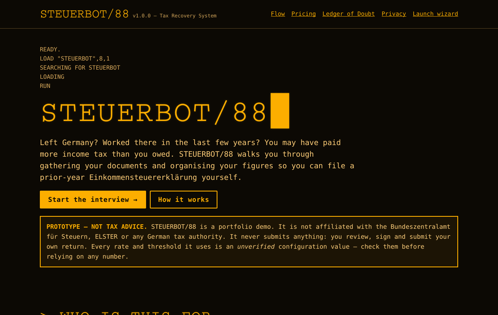
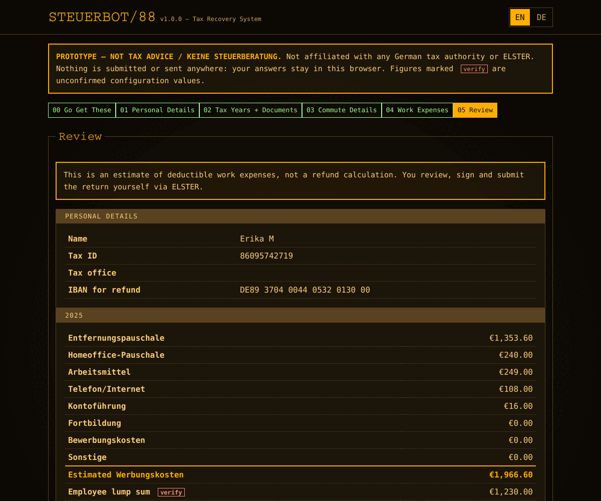
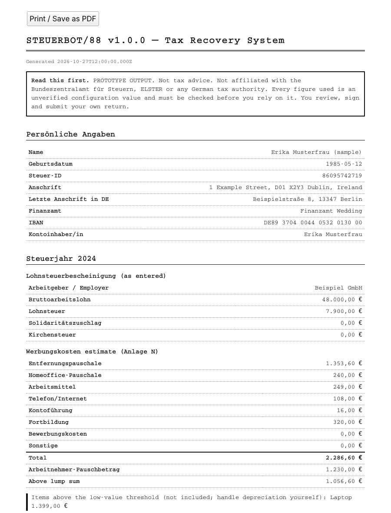

# STEUERBOT/88

### `v1.0.0 — Tax Recovery System`

> **Prototype. Not tax advice. Not affiliated with the Bundeszentralamt für Steuern, ELSTER or any German tax authority. Every rate and threshold in it is unverified.**
> STEUERBOT/88 is a working demo built as a portfolio piece. It submits nothing to anyone, and you shouldn't rely on any figure it shows until a qualified person has checked the config.



---

## Overture: a lament for the lost euro

Somewhere beneath Germany, past the Lohnsteuerbescheinigungen and the Anlage N, below the reading rooms of a thousand Finanzämter, lie the euros of the departed. You left Germany. You moved to Dublin or Lisbon or a damp cottage with a view of the Irish Sea. Each month your employer handed a share of your wages to the State, worked out on the assumption that you would stay put and earn the same all year. You did neither. You never filed a return because nobody made you, and the overpayment sank quietly into the archive like a coin dropped down a well.

STEUERBOT/88 is the bucket on the end of the rope.

It's a small, stubborn machine dressed as an amber-phosphor terminal from 1988. It interviews you in English or German, tells you which documents to dig out of the attic, checks your tax ID and IBAN with the same check-digit arithmetic the banks and the Bundeszentralamt use, and works out what your *Werbungskosten* (deductible work expenses) might come to for each year. Then it hands everything back to you as a tidy summary to carry into ELSTER, where **you** review, sign and submit the return yourself.

It never phones home. It has no back office and no "send" button. And, which matters most, it isn't sure of its own numbers: every rate it uses sits in one config file under a flag that says *verify before shipping*. Consider it a well-meaning poltergeist with a calculator and a disclaimer.

---

## Who it's for

- **The departed:** people who were employed in Germany, have since moved abroad, and never filed an *Einkommensteuererklärung* for those years.
- **The paperwork-averse:** people who'd rather be handed a checklist than spend an evening with the *Einkommensteuergesetz*.
- **The self-filers:** people happy to type the final figures into ELSTER (or onto the paper forms) themselves once someone has laid them out in order.

It isn't for the self-employed, for anyone with rental, investment or foreign income to declare, or for anyone who needs advice. Those people need a *Steuerberater* or a *Lohnsteuerhilfeverein*, and so, eventually, does this config file.

---

## The flow

Six screens, numbered from zero like any self-respecting machine:

| # | Step | German label | What happens |
|---|------|--------------|--------------|
| 00 | **Go Get These** | Unterlagen besorgen | A checklist of documents to gather first: each Lohnsteuerbescheinigung, Steuer-ID, IBAN, last Finanzamt, commute facts, receipts, ELSTER access. |
| 01 | **Personal Details** | Persönliche Angaben | Name, date of birth, addresses, Finanzamt. The **Steuer-ID** is checked against the ISO 7064 MOD 11,10 check digit and the digit-pattern rule. The **IBAN** is checked by country length and the ISO 13616 mod-97 checksum. |
| 02 | **Tax Years + Documents** | Steuerjahre + Unterlagen | Pick a plan (2 or 4 years) and the years themselves, then enter gross wages and withheld tax from each year's Lohnsteuerbescheinigung. |
| 03 | **Commute Details** | Entfernungspauschale | One-way distance and days travelled, priced per km from that year's config, with a live preview. |
| 04 | **Werbungskosten** | Werbungskosten | Home-office days, work equipment (items over the low-value threshold are listed separately, not counted), phone/internet flat rate, bank-fee flat rate, training, job applications, other. |
| 05 | **Review** | Überprüfung | A per-year total compared with the Arbeitnehmer-Pauschbetrag (employee lump sum), plus export to **JSON** or a **printable HTML summary** (print it, or use *Save as PDF* in your browser). |



The printable summary is plain black on white, built for paper and for the long squint at ELSTER that comes after:



*(The sample person is fictional. `scripts/sample-summary.js` regenerates that HTML from the real export code.)*

What the Review step **does not** do: calculate your income tax, predict a refund, or file anything. It estimates one column of one form and leaves the rest to you.

Every label carries its translation underneath in a smaller line, so the German form terms stay in view while you work in English, which helps when the ELSTER screen in front of you refuses to speak anything else. The **EN / DE** switch in the corner swaps which language leads.

---

## Pricing (planned, not live)

One-time purchase. No subscription and no auto-renewal.

| Plan | Covers | Price |
|------|--------|-------|
| **Last 2 Years** / *Letzte 2 Jahre* | two prior tax years | **€19.99** |
| **Last 4 Years** / *Letzte 4 Jahre* | up to four prior tax years | **€29.99** |

**No payment provider is wired up.** The landing page shows these prices with "Coming soon" buttons that are deliberately disabled. In the wizard, the plan only limits how many years you can tick, and the export records `"paid": false`. The demo is free to use. The four-year plan also depends on the filing window, which sits in the Ledger of Doubt below.

---

## The Ledger of Doubt

Here the machine confesses. Every number below lives in [`js/config.js`](js/config.js), wrapped as `{ value, verify: true, note }`. **None of them has been confirmed by a tax professional.** They're my best reading of the rules, entered for the sake of a working prototype, and some may be wrong, out of date or oversimplified. A test (`test/config.test.js`) fails if any value loses its `verify` flag without the test being updated on purpose. The landing page builds its own copy of this table live from the same file.

### The five open questions

| Setting (`js/config.js`) | Prototype value | What it assumes |
|---|---|---|
| `GLOBAL.filingWindowYears` | **4** | A voluntary assessment (*Antragsveranlagung*) can be filed for up to four years after the tax year ends. Decides which years can be picked and whether the 4-year plan makes sense. |
| `GLOBAL.arbeitsmittelThresholdGross` | **€952** | Work equipment up to €952 gross (€800 net) is deductible in full in the year of purchase. Anything dearer is left out of the estimate and flagged for depreciation (AfA), which you handle yourself. |
| `GLOBAL.homeofficeCapAnnual` | **€1,260** | Annual ceiling on the Homeoffice-Pauschale. Applied together with each year's own cap, whichever is lower. |
| `GLOBAL.ibanAllowedCountries` | **34 SEPA-area codes** | That the Finanzamt will pay a refund into any SEPA-area account. An IBAN from outside the list is rejected. |
| `GLOBAL.telefonPauschaleDefaultOn` | **true** | The phone/internet flat-rate toggle starts switched on. Whether that's a sensible default is unconfirmed. |

### The supporting cast (also unverified)

| Setting | Prototype value |
|---|---|
| `GLOBAL.telefonShare` / `telefonMonthlyCap` | 20% of the bill, max €20/month |
| `GLOBAL.kontofuehrungPauschale` | €16/year (a common administrative practice, not a statute) |
| `TAX_YEARS[y].commute` | €0.30/km for km 1–20 in every year; from km 21: €0.35 (2021), €0.38 (2022–2025); €4,500 cap without own car |
| `TAX_YEARS[y].arbeitnehmerPauschbetrag` | €1,000 (2021), €1,200 (2022), €1,230 (2023–2025) |
| `TAX_YEARS[y].homeoffice` | €5/day, max 120 days, cap €600 (2021–2022); €6/day, max 210 days, cap €1,260 (2023–2025) |

Years configured: **2021–2025**. A year with no config block can't be selected, and asking for one throws `UnsupportedYearError`, so it never falls back quietly to the wrong year's figures.

The model is also simplified in ways no single config value can capture: one employer per year, no part-year residency or *Progressionsvorbehalt*, no double household, no business trips, no depreciation schedule. The roadmap has more.

---

## Privacy: everything stays on your machine

- **No server, no API, no analytics.** The pages are static files and load no third-party scripts, fonts or trackers. The font stack asks for VT323 and IBM Plex Mono *if you have them installed*, and otherwise falls back to your system monospace.
- **Progress is saved in your browser's `localStorage`** under the key `steuerbot88.wizard.v1`. Every read and write is wrapped in `try/catch`. If storage is blocked (private browsing, strict settings), the wizard keeps working in memory and says so in the status line.
- **Exports are built in the browser** and downloaded straight to your device.
- **"Wipe local data"** at the bottom of the wizard clears the lot.
- The bundled `npm start` server listens on `127.0.0.1` only and refuses to serve `.git/` or `node_modules/`.

Mind that a Steuer-ID and an IBAN are sensitive. On a shared computer, use the wipe button when you're done.

---

## Running it locally

You need **Node.js 20 or newer**. There are no dependencies to install: no framework, no bundler, no `node_modules`.

```bash
git clone <this repo> steuerbot88
cd steuerbot88
npm start            # serves http://localhost:8088/
```

Open <http://localhost:8088/> for the landing page, or <http://localhost:8088/wizard.html> to go straight to the interview. Set `PORT=9000 npm start` for a different port.

Why a server at all? The app uses native ES modules, and most browsers won't load those from a `file://` URL. Any static server works just as well (`python3 -m http.server`, for one).

---

## Tests

```bash
npm test
```

This runs Node's built-in test runner (`node --test`), so nothing extra gets installed. At the time of the v1.0.0 commit: **36 tests, 36 passing.**

| File | Covers |
|------|--------|
| `test/validate.test.js` | IBAN mod-97 checksum, length, country and format errors; Steuer-ID check digit, digit-pattern and leading-zero rules; German/English amount parsing (`1.234,56`, `48.000`, `1,234.56`) |
| `test/calc.test.js` | Commute tiers per year, whole-km rounding, the €4,500 cap with and without a car; home-office day and euro caps; Telefon-Pauschale cap and default; the equipment threshold split; full per-year Werbungskosten totals versus the lump sum |
| `test/config.test.js` | Per-year config lookup, string years, `UnsupportedYearError`, eligible-year window, and a guard that every figure still carries `verify: true` |
| `test/state.test.js` | localStorage round-trip, corrupt JSON, schema mismatch, old saves upgraded with new fields, storage that throws on every call, no storage at all, wiping, per-step validation rules, and export JSON/HTML (including HTML escaping) |

The browser layer (`js/wizard.js`) has no automated test in the repo. It was walked through all six steps under jsdom during development: validation blocking, the live commute preview, the language switch, persistence and the wipe.

---

## Project layout

```
steuerbot88/
├── index.html              Landing page: pitch, flow, planned pricing, live Ledger of Doubt, privacy
├── wizard.html             The six-step interview (shell; content rendered by js/wizard.js)
├── css/
│   └── terminal.css        Amber CRT theme: scanlines, glow, reduced-motion and print overrides
├── js/
│   ├── config.js           ★ Every rate, threshold and price, each flagged verify: true
│   ├── validate.js         IBAN, Steuer-ID, amounts, numbers, email (pure)
│   ├── calc.js             Commute, home office, phone, equipment, Werbungskosten totals (pure)
│   ├── state.js            Wizard state model + safe localStorage persistence
│   ├── rules.js            Per-step validation rules
│   ├── export.js           JSON and printable-HTML summary builders (pure)
│   ├── i18n.js             English/German label table
│   └── wizard.js           DOM rendering and event handling
├── scripts/
│   ├── serve.js            Zero-dependency static server for `npm start`
│   └── sample-summary.js   Prints a printable summary for a fictional sample person
├── test/                   node:test suites (see above)
├── docs/                   Screenshots used in this README
├── package.json
├── LICENSE                 MIT
└── README.md
```

Everything that does arithmetic or validation is a pure ES module with no DOM access, which is why it can be tested in Node without a browser.

---

## Accessibility

Body text is warm amber on near-black, well above WCAG AA contrast. The CRT effects are decorative: the flicker and blinking cursor stop under `prefers-reduced-motion`, and the scanlines vanish when printing. Every input has a real `<label>`. Errors are linked with `aria-describedby` and marked `aria-invalid`, focus moves to the first bad field, the progress bar uses `aria-current="step"`, and there's a skip link. Nobody has run a formal audit with a screen reader, so take this list as intent rather than certification.

---

## Roadmap

Roughly in the order the bureaucratic deep demands:

1. **Get the Ledger of Doubt checked** by a Steuerberater or Lohnsteuerhilfeverein, and record the source and date for each figure in `config.js`.
2. Support **several employers per year** and part-year employment.
3. **Map each summary line to its ELSTER form and line number** (Anlage N and the main form), year by year.
4. Handle **Arbeitsmittel depreciation** properly instead of only flagging dear items.
5. Add **double household, business travel and union dues** to the Werbungskosten.
6. Add a rough **refund estimate**, clearly labelled, once the tax-tariff maths can be tested year by year.
7. Bring in **payments** (one-time, matching the pricing above) and only then think of calling it a product.
8. Add browser-level end-to-end tests (Playwright) for `wizard.js`.

---

## Licence

[MIT](LICENSE) — Copyright (c) 2026 Niall O'Hara.

The code is offered as-is, without warranty, as the licence says. The figures are offered with even less. Nothing in this repository is tax advice, and STEUERBOT/88 has no connection with any German tax authority. Check every number, then check it again, and good luck down the well.
