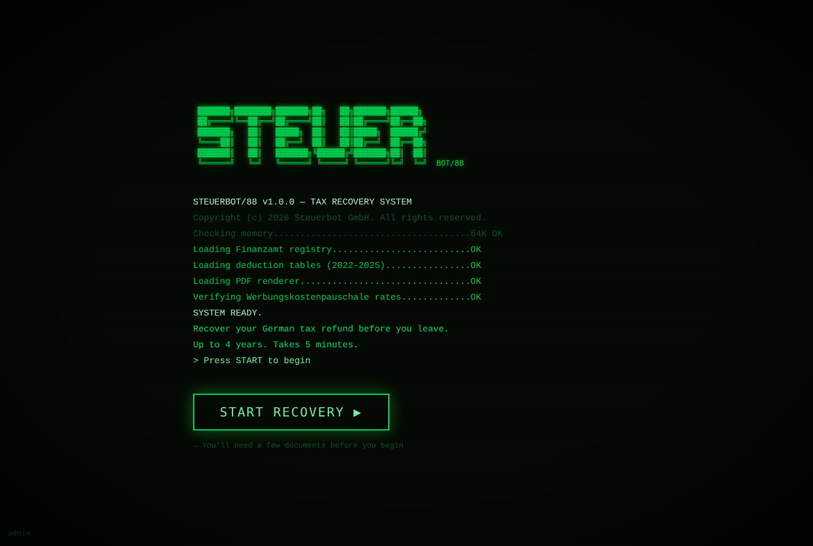

# STEUERBOT/88 · The Figma Make MVP
### *The green-phosphor original, rescued from the cloud and taught to stand on its own two feet*

> **Prototype. Not tax advice. Not affiliated with any German tax authority. Every figure must be verified before real use.**



This folder is the **first** STEUERBOT/88: the version designed and grown, over 36 iterations, inside **Figma Make**. It lived on Figma's servers, which is a fine place for a design and a poor place for a product. So it has been carried out, plank by plank, and rebuilt as an ordinary web project you can run on your own machine, deploy anywhere, and keep under version control.

Where the parent project (`../`) is a dependency-free, test-covered rebuild, this is the richer original: React, Tailwind and a real Stripe checkout.

## What it does

- **Boots like a 1988 terminal.** ASCII logo, a scrolling boot log, then *START RECOVERY*.
- **"Go Get These" checklist** of the documents worth hunting down before you start.
- **Personal details → tax years → document upload.**
- **Reads your Lohnsteuerbescheinigung.** Drop in the PDF and it pulls out the year, gross wages, income tax, solidarity surcharge and church tax (boxes 1–4) using `pdfjs-dist`, with a confidence rating for each parse. All in the browser.
- **Pre-flight check, commute, Werbungskosten**, then a **review** that runs the numbers per year.
- **Paywall via Stripe** (€19.99 for 2 years, €29.99 for 4), backed by a tiny Supabase Edge Function that creates the payment.
- **Exports** your completed summary as PDF and ZIP (`jspdf`, `jszip`).
- A faint **admin** button in the bottom-left corner fills the whole flow with demo data, for showing it off.

## Run it

```bash
cd mvp
npm install
cp .env.example .env     # then add your Stripe TEST key
npm run dev              # http://localhost:5173
```

`npm run build` produces a static site in `dist/` you can drop onto Netlify.

## Payments

The browser never holds a secret. Two settings go in `.env`:

| Variable | What it is |
|---|---|
| `VITE_STRIPE_PUBLISHABLE_KEY` | Your Stripe **publishable** key. Use `pk_test_…` until you're ready. |
| `VITE_PAYMENT_INTENT_URL` | The address of the payment function below. |

Without them the app runs fine; the checkout simply reports it can't reach the payment server.

The server half lives in `supabase/functions/server/index.tsx`. Deploy it as a Supabase Edge Function and set the secret there:

```bash
supabase secrets set STRIPE_SECRET_KEY=sk_test_...
supabase functions deploy server
```

It only accepts the two published plan prices, so nobody can talk the checkout into charging them a euro.

## What changed on the way out of Figma

- Added the missing entry point (`index.html`, `src/main.tsx`) that Figma Make supplies behind the scenes.
- Moved the Stripe key and server address out of the code and into `.env`.
- Trimmed the dependency list from Figma's ~60 starter packages to the 8 the app actually uses.
- The payment function now rejects any amount except €19.99 and €29.99.
- Replaced a placeholder "Steuerbot GmbH" copyright line, since no such company exists.

## Status

A working prototype, not a live service. The tax rates, thresholds and filing rules are flagged as unverified in the parent project's *Ledger of Doubt*; the same caution applies here.

Licence: MIT, see [`../LICENSE`](../LICENSE).
